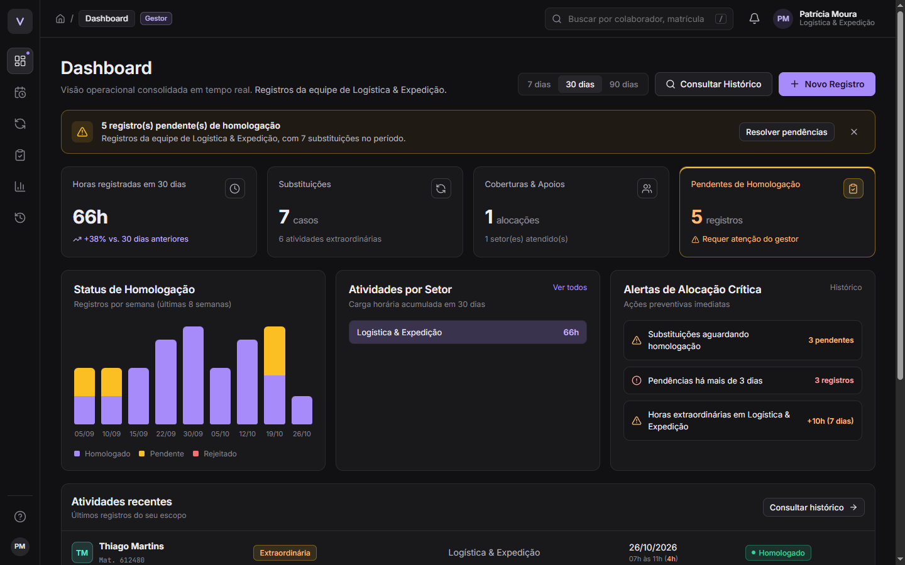

# SIGAF, Sistema de Registro e Gestão de Atividades Funcionais

> Solução centralizada, confiável e padronizada para o registro, rastreamento e gestão de substituições e atividades funcionais. Desafio SAGA SENAI, Análise e Desenvolvimento de Sistemas, 2026.

**Equipe:** Gabriel Morais Pinto, Jonathan Willian de Paula Santos, Kauê Alexandre Souza, Micael Silva Domiciano e Miguel Viana Laube.

**Orientador:** Prof.º Wesley Fioreze.



---

## 🛠️ Tecnologias

| Camada | Tecnologia |
|---|---|
| Back-end / API REST | **Node.js** 20+, Express 5, JWT, bcrypt e Helmet |
| Front-end | **Vue.js 3**, Vite, Vue Router, Pinia e Lucide Icons |
| Banco de dados | **MySQL** / MariaDB (testado no MariaDB 10.4 do XAMPP) |
| Relatórios | PDFKit (PDF), ExcelJS (Excel) e CSV |
| Testes | `node:test` + Supertest (32 testes) |

## 🧩 Arquitetura

```
SIGAF/
├── backend/                  API REST (Node.js + Express)
│   ├── src/
│   │   ├── domain/           Classes do Diagrama de Classes (Usuario, Setor, Disciplina,
│   │   │                     RegistroAtividade, Relatorio + enums PerfilUsuario/CategoriaAtividade)
│   │   ├── modules/          Um módulo por componente dos diagramas de sequência
│   │   │   ├── auth/           Serviço de Autenticação e Controle de Acesso (RF05)
│   │   │   ├── apontamentos/   Sistema de Apontamentos (RF01)
│   │   │   ├── registros/      Sistema/API de Registros (RF02, RF03)
│   │   │   ├── homologacao/    Pendentes de Homologação (aprovar/rejeitar)
│   │   │   ├── relatorios/     Módulo + Processador de Relatórios (RF04)
│   │   │   ├── dashboard/      Painel Centralizado (RF05)
│   │   │   ├── notificacoes/   Serviço de Notificação (sistema + e-mail opcional)
│   │   │   ├── auditoria/      Logs auditáveis (RNF06)
│   │   │   └── cadastros/      Usuários, setores e disciplinas
│   │   ├── middlewares/      autenticar / autorizar (Serviço de Autorização), tempo de resposta
│   │   ├── database/         schema.sql + setup.js (cria o banco e popula dados de demonstração)
│   │   └── utils/            criptografia AES-256-GCM, gerador de certificado HTTPS
│   └── tests/                testes de unidade e de integração
├── frontend/                 Interface web (Vue.js 3)
│   └── src/
│       ├── views/            Login, Dashboard, Atividades, Novo Registro, Substituições,
│       │                     Homologação, Relatórios, Auditoria, Cadastros
│       ├── components/       Layout (menu lateral do protótipo), cartões, modais…
│       └── domain/           RegistroAtividade.js (mesmas validações do back-end)
└── docs/
    ├── evidencias/           Prints do sistema funcionando + saídas de teste
    ├── EVIDENCIAS.md         O que cada print comprova
    └── RASTREABILIDADE.md    Matriz de requisito, código, teste e evidência
```

## ▶️ Como rodar

**Pré-requisitos:** Node.js 20 ou superior e MySQL/MariaDB rodando (o XAMPP serve: inicie o MySQL pelo painel).

```bash
# 1) Back-end
cd backend
npm install
cp .env.example .env          # ajuste DB_USER / DB_PASSWORD se o seu MySQL tiver senha
npm run db:setup              # cria o banco "sigaf" e popula dados de demonstração
npm start                     # API em http://localhost:3333
```

```bash
# 2) Front-end (em outro terminal)
cd frontend
npm install
npm run dev                   # interface em http://localhost:5173
```

**Acessos de demonstração** (senha `Sigaf@2026` para todos):

| Perfil | E-mail | O que vê |
|---|---|---|
| Colaborador | `colaborador@sigaf.com` | só os próprios registros |
| Gestor | `gestor@sigaf.com` | registros da equipe (Logística & Expedição), homologação, relatórios |
| Administrador | `admin@sigaf.com` | tudo + cadastros e auditoria |

### Outros comandos

```bash
npm test                      # (em backend/) roda os 32 testes, precisa do banco populado
npm run gerar-certificado     # (em backend/) gera certificado autoassinado; depois HTTPS_ENABLED=true no .env
```

## ✅ Requisitos atendidos

| Requisito | Onde está |
|---|---|
| **RF01** Registro de atividades e substituições | Tela *Novo Registro* com escolha da categoria (4 opções) e depois o formulário; botão **Cancelar** descarta os dados (A1) |
| **RF02** Detalhamento da atividade | Executor, profissional substituído, data, início/fim, setor, disciplina e tarefas; campos vazios ficam **em vermelho** (A1) e fim antes do início gera **alerta** (A2); “Registro salvo com sucesso” |
| **RF03** Consulta de histórico | Tela *Atividades*: filtros por data, profissional, setor, tipo e status, detalhes completos; “Nenhum registro encontrado para os filtros informados” + *Limpar busca* (A1) |
| **RF04** Relatórios e prestação de contas | Tela *Relatórios*: período, setor, profissional e formato (PDF, Excel ou CSV) com download automático; acima de 100 registros vai para **segundo plano** e notifica quando pronto (A1) |
| **RF05** Painel centralizado | Login leva ao *Dashboard* com resumo, atalhos “Novo Registro” e “Consultar Histórico”; visão por perfil (A1) |
| Homologação (diagrama de sequência) | Tela *Homologação*: aprovar ou rejeitar com justificativa; colaborador é notificado |
| **RNF01** Segurança | HTTPS opcional (certificado + HSTS), CPF criptografado com **AES-256-GCM**, senhas com bcrypt, JWT |
| **RNF02** Disponibilidade | `GET /api/health` para monitoramento de uptime |
| **RNF03** Tempo de resposta ≤ 2 s | Cabeçalho `X-Response-Time` em toda resposta, índices no banco, relatórios grandes assíncronos |
| **RNF04** Responsividade | Layout adapta para celular (menu vira barra inferior) |
| **RNF05** Modularidade / API REST | Um módulo por componente; API REST documentada abaixo |
| **RNF06** Auditabilidade | Tabela `logs_auditoria` (usuário, data/hora, ação) gravada na mesma transação; tela *Auditoria* |
| **RN01** Obrigatoriedade | Validada no front-end **e** na API |
| **RN02** Escopo MVP | Integrações externas ficaram fora (apenas preparadas via API REST) |

Detalhes e prints em [docs/EVIDENCIAS.md](docs/EVIDENCIAS.md). Matriz completa em [docs/RASTREABILIDADE.md](docs/RASTREABILIDADE.md).

## 🔌 API REST

Todas as rotas (exceto login e health) exigem `Authorization: Bearer <token>`.

| Método | Rota | Perfil | Descrição |
|---|---|---|---|
| POST | `/api/auth/login` | público | Autentica e devolve token + perfil |
| GET | `/api/auth/me` | todos | Usuário logado |
| GET | `/api/apontamentos/categorias` | todos | Categorias de registro (RF01) |
| GET | `/api/apontamentos/formulario?categoria=` | todos | Habilita o formulário da categoria (RF01) |
| GET | `/api/registros` | todos* | Histórico com filtros e paginação (RF03) |
| GET | `/api/registros/:id` | todos* | Detalhe do registro |
| POST / PUT / DELETE | `/api/registros[/:id]` | todos* | Criar / alterar / excluir (RF02) |
| GET | `/api/homologacao/pendentes` | gestor, admin | Registros pendentes |
| PATCH | `/api/homologacao/:id` | gestor, admin | `{ decisao: APROVAR \| REJEITAR, justificativa }` |
| GET | `/api/relatorios/parametros` | gestor, admin | Setores, profissionais e formatos |
| POST | `/api/relatorios` | gestor, admin | Gera relatório (201 = pronto, 202 = segundo plano) |
| GET | `/api/relatorios/:id/arquivo` | gestor, admin | Download do arquivo |
| GET | `/api/dashboard?dias=7\|30\|90` | todos* | Dados do painel (RF05) |
| GET / PATCH | `/api/notificacoes` | todos | Notificações do usuário |
| GET | `/api/auditoria` | gestor, admin | Logs de auditoria |
| GET / POST / PUT | `/api/cadastros/{usuarios,setores,disciplinas}` | admin (leitura liberada) | Cadastros |
| GET | `/api/health` | público | Disponibilidade |

\* o resultado é recortado pelo perfil: colaborador vê os próprios registros, gestor vê a equipe do seu setor, administrador vê tudo.

## 📝 Ajustes em relação ao documento

Pontos em que o código precisou ir um pouco além do diagrama de classes para atender aos fluxos descritos (sugerimos atualizar o diagrama na próxima versão da ERS):

1. **`RegistroAtividade`** ganhou `status` (PENDENTE / HOMOLOGADO / REJEITADO), `justificativa`, `homologadoPor` e `homologadoEm`, exigidos pelo diagrama de sequência de homologação, mas ausentes no diagrama de classes.
2. **`Usuario`** ganhou `senhaHash` (necessário para `autenticar()`) e `setor` (lotação), necessário para `Setor.listarProfissionais()` e para o gestor ver “a equipe sob sua supervisão” (RF05 A1).
3. **`Relatorio`** ganhou filtro opcional de `profissional` (RF04 pede “Profissional específico”) e o formato **CSV** (citado no caso de uso de Geração de Relatórios).
4. Foram criadas as tabelas `notificacoes` (Serviço de Notificação) e `logs_auditoria` (RNF06).
5. O limite para o relatório ir para segundo plano é configurável (`REPORT_ASYNC_THRESHOLD`, padrão 100 registros).
6. O envio de e-mail do Serviço de Notificação funciona se as variáveis `SMTP_*` forem preenchidas; sem elas, as notificações aparecem só no sino do sistema.
